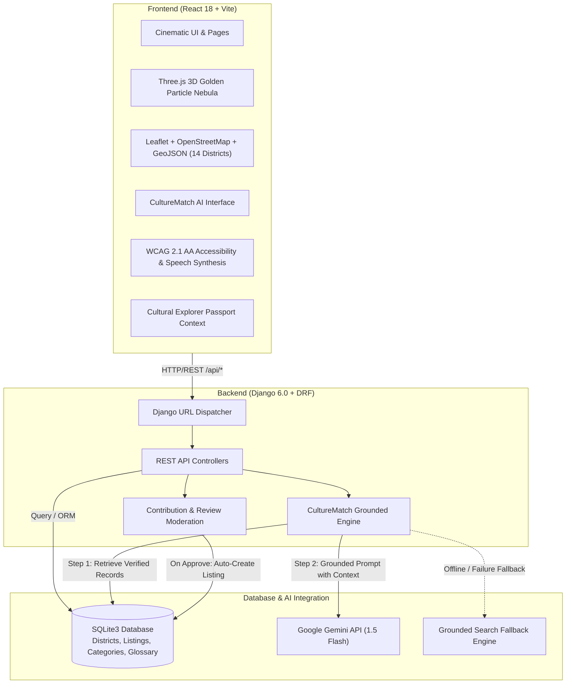
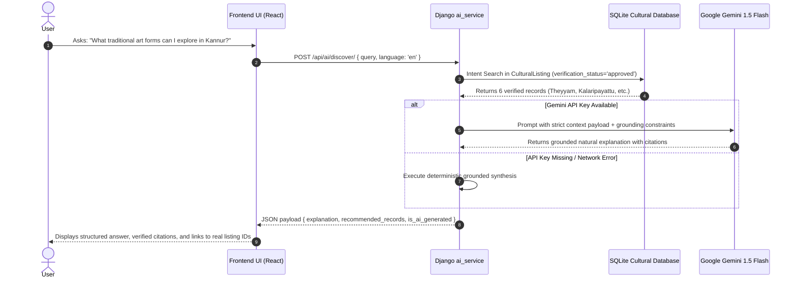
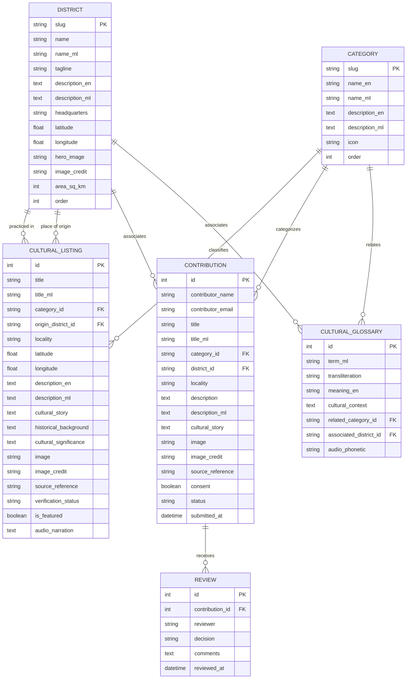
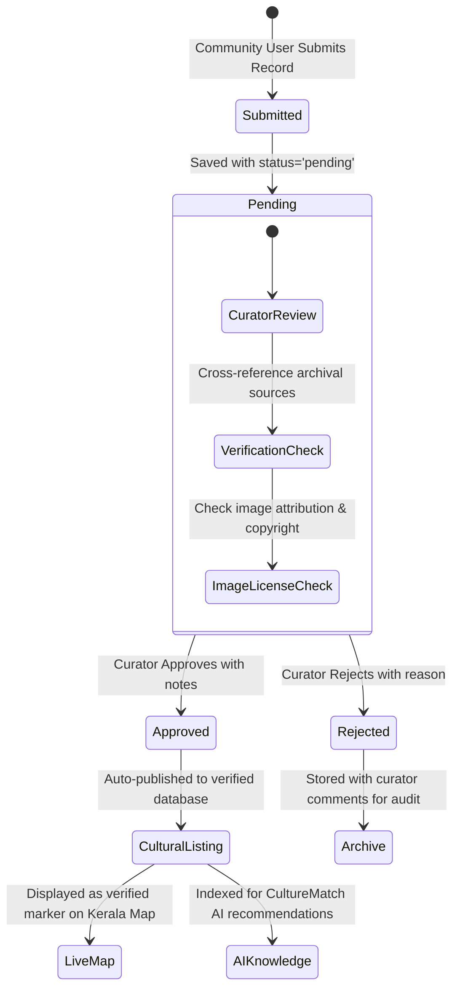

# OORVEX Architecture & Technical Design Document

This document outlines the technical design, data architecture, security measures, and AI grounding workflows of **OORVEX: The Digital Universe of Kerala's Culture**.

---

## 1. System Architecture Overview

---

## 2. CultureMatch AI Retrieval-Grounded Pipeline

To prevent cultural hallucination, CultureMatch AI uses a strict retrieval-first generation architecture:

### Strict Grounding Rules:
1. Only records with `verification_status = 'approved'` are retrieved.
2. The AI prompt explicitly forbids answering outside the supplied database context.
3. Every recommendation returns the actual primary key `id` so the frontend can route directly to the detail view (`/cultural-listings/${id}`).
4. If no verified records exist for a query, the model explicitly responds that no verified archive record exists, preventing hallucinated origins or communities.

---

## 3. Database Entity Relationship (ER) Model

---

## 4. Community Contribution & Moderation Workflow

---

## 5. Accessibility & Performance Architecture

- **WCAG 2.1 AA Compliance**:
  * Semantic HTML tags (`<header>`, `<nav>`, `<main>`, `<footer>`, `<section>`, `<article>`)
  * Dynamic font size scaling (`100%`, `115%`, `130%`)
  * High-contrast mode enforcing pure black background with gold borders and white text
  * Reduced-motion toggle (`prefers-reduced-motion`) that disables Three.js particle rendering and CSS transitions
  * Text-to-speech audio reader utilizing Web Speech API (`SpeechSynthesisUtterance`)
- **Bundle Optimization**:
  * Code-split vendor chunks (`vendor-three`, `vendor-leaflet`, `vendor-react`)
  * Total main JS bundle gzipped size is under 70 kB
  * Lazy loading for all cultural imagery with aspect ratio preservation to avoid layout shift (CLS < 0.05).
